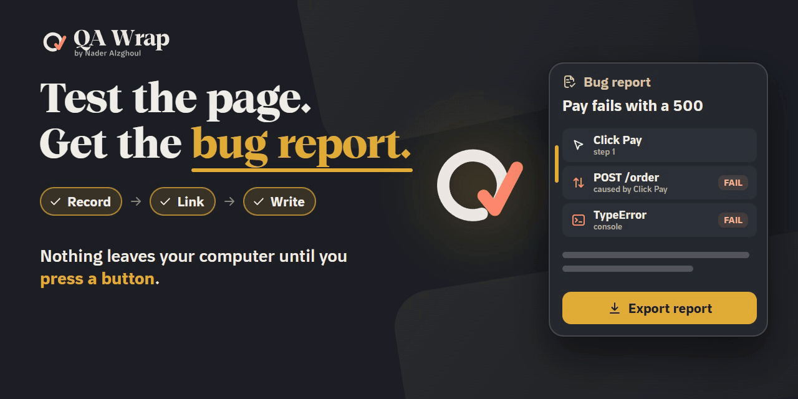

# 🧪 QA-Wrap: إضافة مجانية ومفتوحة المصدر لتقارير الأخطاء لمختبري الجودة

### اختبر الصفحة. خذ تقرير الخلل جاهزًا.

### 🔒 لا شيء يغادر حاسوبك حتى ترسله إلى Jira أو أداة تتبع أو ويب هوك.

**QA-Wrap إضافة متصفح مجانية ومفتوحة المصدر لكتابة تقارير الأخطاء، صُنعت لمختبري الجودة.** تسجّل جلسة الاختبار اليدوي، وتربط كل خلل بالإجراء الذي سبّبه، وتكتب لك تقرير الخلل. بلا حساب وبلا خادم. [English](README.md)

من [نادر الزغول (NJ-Burrito)](https://nj-burrito.github.io/)، مهندس أتمتة جودة في عمّان، الأردن.

🌐 [الموقع](https://nj-burrito.github.io/QA-Wrap/) · ⬇️ [تنزيل آخر إصدار](https://github.com/NJ-Burrito/QA-Wrap/releases/latest) · ✨ [الجديد](#الجديد) · 📥 [احصل عليها](#احصل-عليها) · ⚖️ [مقارنة](#مقارنة) · ❓ [أسئلة](#أسئلة) · 🚀 [التثبيت](#التثبيت) · 🔄 [التحديثات](#التحديثات) · 🔒 [الخصوصية](#الخصوصية) · 🧰 [أدوات أخرى](#عن-المشروع)

## ⚡ في 10 ثوانٍ

- 🎯 **ما هي:** إضافة للمتصفح تسجّل اختبارك وتكتب تقرير الخلل.
- 🙋 **لمن:** لمن يختبر صفحات الويب ويتعب من إعادة كتابة الخطوات والبحث عن النقرة التي سبّبت كل خلل.
- 🔒 **آمنة:** كل شيء يبقى على حاسوبك حتى ترسله إلى Jira أو أداة تتبع أو ويب هوك.

## 📥 احصل على QA-Wrap

| | أين | الحالة |
| --- | --- | --- |
| 🦊 **Firefox** | [إضافات Firefox](https://addons.mozilla.org/firefox/addon/qa-wrap/) | ✅ متاحة (3.8.0، والإصدار 3.9.0 قادم) |
| 🟢 **Chrome** | [ملف الإصدار على GitHub](https://github.com/NJ-Burrito/QA-Wrap/releases/latest) ([الخطوات](#التثبيت)) | ✅ متاحة (ليست في متجر Chrome) |
| 🔷 **Edge** | [إضافات Microsoft Edge](https://microsoftedge.microsoft.com/addons/detail/nidbfaeniiaagkecgkiapcebojbjfbha) | ✅ متاحة (3.8.0، والإصدار 3.9.0 قدم في 2026-11-10 وهو قيد المراجعة) |
| 🎭 **Opera** | إضافات Opera | ⏳ لم تنشر بعد (قدمت في 2026-10-23)؛ استخدم ملف `opera` من صفحة الإصدار حتى ذلك الحين |
| 🤖 **جسر MCP** (npm) | [qa-wrap-bridge](https://www.npmjs.com/package/qa-wrap-bridge) الإصدار 0.1.0 | ✅ متاح |
| 📚 **سجل MCP** | [io.github.NJ-Burrito/qa-wrap-bridge](https://registry.modelcontextprotocol.io/v0/servers?search=qa-wrap-bridge) | ✅ متاح |

قُدّمت أيضًا إلى Glama وmcpservers.org وmcp.directory و[awesome-mcp-servers](https://github.com/punkpeye/awesome-mcp-servers/pull/17378) و[سوق Cline](https://github.com/cline/mcp-marketplace/issues/3206)، وكلها بانتظار المراجعة.

## 🛠️ ماذا تفعل

- 🎬 **تسجّل الجلسة**: تضغط ابدأ، تختبر كالمعتاد، ثم تضغط أوقف. تُحفظ النقرات والكتابة (مع إزالة القيم الحسّاسة) وأخطاء الصفحة وإخفاقات الشبكة بالترتيب.
- 🔗 **تربط كل خلل بسببه**: يُظهر التقرير الإجراء الذي سبق كل مشكلة.
- 📝 **تكتب التقرير**: ضغطة واحدة تنسخ تقرير خلل جاهزًا (العنوان والخطوات وما حدث والأدلة). والإرسال إلى Jira وغيره زر واحد.
- 🌍 **عربي وإنجليزي** معًا، والاتجاه من اليمين إلى اليسار حيث يلزم.

🎞️ شاهد QA-Wrap وهو يعمل · 40 ثانية: [بالعربية](https://nj-burrito.github.io/QA-Wrap/media/qa-wrap-commercial-40s-ar.mp4) · [English](https://nj-burrito.github.io/QA-Wrap/media/qa-wrap-commercial-40s.mp4)

🎬 ستة أفلام أخرى، كل منها بالعربية والإنجليزية، على [الموقع](https://nj-burrito.github.io/QA-Wrap/#films): كل لحظة محفوظة · تقرير واحد لكل مكتب · أره ولا تصفه · عدة الاختبار كاملة · عملك، مختوم · بلغتك، وبأرقامك، ومع وكيلك.

## ✨ الجديد في 3.9.3

- 📦 **نسخ المتاجر تتحدث من المتجر.** حزم Edge وFirefox وOpera لا تحمل أداة تحديث خاصة بها.

## ✨ الجديد في 3.9.2

- 🏷️ **التقرير يحمل اسم جلستك.** عنوانه هو اسم الجلسة الذي كتبته، وينتقل الخلل إلى صف «ما الذي تعطل».
- ⏪ **إعادة التشغيل عبر الصفحات.** الجلسة التي تنقلت بين صفحات تعيد الصفحة كما كانت، بطولها الحقيقي وعلاماتها الحمراء على المسار.
- 🎬 **ستة أفلام جديدة**، كل منها بالعربية والإنجليزية، تُشغَّل داخل الصفحة على [الموقع](https://nj-burrito.github.io/QA-Wrap/#films).

## ✨ الجديد في 3.9.1

- 🪪 **تبويب الملف الشخصي وشارة الشريط العلوي.** صار للملف الشخصي تبويبه الخاص في الإعدادات، باسمك بالإنجليزية واسمك بالعربية. وتظهر صورتك واسمك في آخر الشريط العلوي بلغة QA-Wrap التي تستعملها. تبقى الصورة على حاسوبك.
- 🧹 **غربلة الشبكة.** لم يعد الخط الزمني يغرق في ضجيج الخلفية (إشارات التحليلات ووسوم الإعلانات المحجوبة والطلبات الملغاة وغياب الأيقونة والخطوط). يُطوى خلف سطر واحد يعدّه ولا يُحذف شيء، وكل تصدير يحتفظ بكل الطلبات. ولا يُخفى أبدا فشل في موقعك أنت، ولا فشل بعد إجرائك مباشرة، ولا فشل طلب مسجّل الدخول.
- 🖱️ **أسماء النقرات.** تحمل النقرة المسجّلة اسم الزر الذي ضُغط، مثل: نقر على «حفظ» (زر). تُزال عناوين البريد وأرقام الهواتف وأرقام البطاقات وسلاسل الأرقام الطويلة، ولا يُقرأ شيء من الحقول ولا كلمات المرور. ومفتاح واحد يوقفها.

## ✨ الجديد في 3.9.0

- 🪪 **ملفك الشخصي.** له تبويب خاص باسم **الملف الشخصي** في الإعدادات: صورتك واسمك بالعربية وبالإنجليزية. يظهران في الشريط العلوي (الاسم بلغة الواجهة، وبطاقة صغيرة فيها الاسمان وزر «تعديل الملف» عند المرور فوقه أو الوصول إليه بالتبويب). وينتهي كل ملف تصدّره بسطر صغير واحد (الاسم والتاريخ وإصدار QA-Wrap) ليُنسب العمل إليك، بالاسم الموافق للغة ذلك الملف. يبقى الاسم والصورة على حاسوبك، ولا يُرسل شيء إلى أي جهة.
- 📄 **خط زمني مختوم (ملف Markdown أي نص منسّق).** صار بإمكان خياري التنزيل أن يضمّا الخط الزمني كاملًا في ملف `.md` مقروء، وفيه ملفك الشخصي وكتلة ختم في آخره.
- 🔎 **التحقق من ملف مختوم.** اختر ملفًا مختومًا، فتخبرك QA-Wrap إن كان **سليمًا** أو **معدّلًا**، ومن ختمه، وبصمة المفتاح، وهل المفتاح لهذا التثبيت.
- 📊 **مؤشرات الأداء (KPI).** الوقت الذي قضيته في الاختبار حسب اليوم والأسبوع والموقع، وتغطية الصفحات (ما اختُبر وما لم يُختبر)، والأخطاء المسجّلة في اليوم والأسبوع، والأخطاء حسب الخطورة، وعدد الجلسات ومتوسط طولها. تُحسب من جلساتك أنت فقط وعلى جهازك، والأخطاء هي الملاحظات التي سجّلتها كخلل فقط. **تصدير بصيغة PDF** يحمل سطر ملفك الشخصي. بالعربية والإنجليزية، والاتجاه من اليمين إلى اليسار حيث يلزم.
- 🎞️ **أفلام باللغتين.** صار للفيلم القصير نسخة عربية بتعليق صوتي وكلمات على الشاشة بالعربية، ومعه ستة دروس قصيرة (سجّل جلسة، تتبّع الخطأ إلى النقرة، الملاحظات والأخطاء، التصدير والختم، الملف الشخصي والسطر الصغير، لوحة مؤشرات الأداء)، كل درس بالعربية والإنجليزية. الأفلام على [الموقع](https://nj-burrito.github.io/QA-Wrap/#tutorials)؛ يفتح الضغط الملف، ولا يُحمَّل شيء قبل أن تضغط.

**ما الختم وما ليس هو.** الختم كاشف للتعديل وليس سرّية. يبقى النص مقروءًا، ويبيّن الختم أن النص لم يتغيّر منذ وقّعه المفتاح الموجود في الملف. ولا يثبت أن الاسم صحيح: يستطيع أي شخص تعديل الملف وختمه من جديد بمفتاحه، فتظهر بصمة مختلفة. قارن البصمة ببصمة تثق بها.

## ⚖️ QA-Wrap مقارنة مع Jam وMarker.io وBugHerd وBird Eats Bug

الأدوات الخمس تبلّغ عن الخلل من المتصفح، وتختلف في كلفة البدء، وفي إمكانية قراءة الشيفرة، وفي مكان حفظ التسجيل.

| الأداة | 💸 كلفة البدء | 📖 الشيفرة المصدرية | 📍 أين يُحفظ التسجيل |
| --- | --- | --- | --- |
| **QA-Wrap** | مجانية، بلا حساب | مفتوحة (MIT) | في متصفحك، حتى ترسله إلى Jira أو أداة تتبع أو ويب هوك |
| Jam | خطة مجانية وخطط مدفوعة | مغلقة المصدر | سحابة Jam |
| Marker.io | فترة تجربة ثم اشتراك مدفوع | مغلقة المصدر | سحابة Marker.io |
| BugHerd | فترة تجربة ثم اشتراك مدفوع | مغلقة المصدر | سحابة BugHerd |
| Bird Eats Bug | خطة مجانية (15 رفعًا في الشهر) وخطط مدفوعة | مغلقة المصدر | سحابة Bird Eats Bug |

من الصفحة الرئيسية وصفحة الأسعار لكل أداة، قُرئت في 24 أكتوبر 2026. الخطط تتغير، فراجع صفحاتهم.

- 🏠 اختر أداة مستضافة حين يريد فريقك روابط مشاركة يفتحها أي شخص.
- 🔒 اختر QA-Wrap حين يجب أن يبقى التسجيل على جهاز المختبِر، أو حين تريد قراءة الشيفرة وتعديلها.

📄 [المقارنة كاملة](https://nj-burrito.github.io/QA-Wrap/alternatives.html)

## ❓ أسئلة شائعة

- 💸 **هل QA-Wrap مجانية؟** نعم. لا خطة مدفوعة ولا حساب، برخصة MIT.
- ⚖️ **هل هي بديل مجاني عن Jam أو Marker.io أو BugHerd؟** نعم، حين يجب أن يبقى التسجيل على جهازك. تلك خدمات مستضافة تشارك التقارير عبر سحابتها، أما QA-Wrap فلا خادم لها.
- 🎫 **هل ترسل الخلل إلى Jira؟** نعم. زر الإرسال إلى Jira يصوغ الملخص، ويحوّل الخطورة إلى أولوية في Jira، ويعرض ما سيُرسل وما لن يُرسل. تُضبط أدوات التتبع الأخرى والويب هوك من الإعدادات.
- 🌐 **أي متصفحات؟** Chrome وEdge هما المتصفحان المختبَران (Chrome 116 أو أحدث). ومستخدمو Edge يثبتونها من [إضافات Microsoft Edge](https://microsoftedge.microsoft.com/addons/detail/nidbfaeniiaagkecgkiapcebojbjfbha)، ومستخدمو Firefox من [إضافات Firefox](https://addons.mozilla.org/firefox/addon/qa-wrap/) (لا يدعم Firefox التقاط التبويب، فتسجيل الشاشة متوقف فيه).
- 🤖 **هل يقرأ وكيل برمجة التقارير؟** نعم، عبر [qa-wrap-bridge](https://www.npmjs.com/package/qa-wrap-bridge)، جسر MCP للقراءة فقط. يبقى متوقفا حتى تشغّل جسر الوكيل من الإعدادات.
- 🌍 **بالعربية؟** نعم. الواجهة والتقارير بالعربية والإنجليزية.

## 🚀 التثبيت

في Chrome تُحمَّل الإضافة يدويًّا من ملف الإصدار لأنها ليست في متجر Chrome، ويشترط Chrome لذلك تشغيل **وضع المطوّر (Developer mode)**. هو مفتاح عادي في Chrome ولا يثبّت شيئًا بنفسه. يلزمك Chrome بإصدار 116 أو أحدث (ويعمل Edge وBrave وChromium بالطريقة نفسها). تعمل على Windows وMac وLinux. المدة نحو ثلاث دقائق، ومرة واحدة فقط.

🌐 متصفحات أخرى (Edge وBrave وOpera وVivaldi وArc وYandex وFirefox وSafari)

| المتصفح | الملف المضغوط (تحت **Assets**) | مكان "Load unpacked" | خطوة أداة التحديث (مرة واحدة) |
| --- | --- | --- | --- |
| Chrome | `qa-wrap-VERSION.zip` | `chrome://extensions` ثم **Developer mode** ثم **Load unpacked** | مجلد `updater`: `install.cmd` أو `install.sh` |
| Edge | `qa-wrap-VERSION-edge.zip` | `edge://extensions` ثم **Developer mode** (القائمة اليسرى) ثم **Load unpacked** | نفسها |
| Brave | `qa-wrap-VERSION-brave.zip` | `brave://extensions` ثم **Developer mode** ثم **Load unpacked** | نفسها |
| Opera | `qa-wrap-VERSION-opera.zip` | `opera://extensions` ثم **Developer mode** ثم **Load unpacked** | نفسها |
| Opera GX | `qa-wrap-VERSION-operagx.zip` | `opera://extensions` ثم **Developer mode** ثم **Load unpacked** | نفسها |
| Vivaldi | `qa-wrap-VERSION.zip` | `vivaldi://extensions` ثم **Developer mode** ثم **Load unpacked** | نفسها |
| Arc | `qa-wrap-VERSION.zip` | `arc://extensions` ثم **Developer mode** ثم **Load unpacked** | نفسها |
| Yandex Browser | `qa-wrap-VERSION.zip` | `browser://extensions` ثم **Developer mode** ثم **Load unpacked** | نفسها |
| Chromium | `qa-wrap-VERSION.zip` | `chrome://extensions` ثم **Developer mode** ثم **Load unpacked** | نفسها |
| Firefox | `qa-wrap-VERSION-firefox.zip` | `about:debugging#/runtime/this-firefox` ثم **Load Temporary Add-on** واختر `manifest.json` | نفسها، عندما تعمل الإضافة موقَّعة (انظر أدناه) |
| Safari | لا يوجد | يلزم جهاز Mac فيه Xcode | غير متاح |

تسجّل خطوة أداة التحديث نفسها لكل متصفح تجده على جهازك وتخبرك بأسمائها. كل متصفح يتحدّث إلى ملفه الخاص، فلا يصل إصدار Firefox أبدًا إلى Edge.

**Firefox:** ثبتها من [إضافات Firefox](https://addons.mozilla.org/firefox/addon/qa-wrap/)، فتبقى مثبتة وتتحدث تلقائيا. الملف المضغوط في الجدول يصلح للتجربة، لكنه يحمل حتى إعادة تشغيل Firefox فقط.

**Safari.** يحتاج Safari إلى جهاز Mac مع Xcode لتحويل النسخة إلى تطبيق (`xcrun safari-web-extension-converter`)، والتحديث بضغطة واحدة غير متاح هناك.

1. افتح [آخر إصدار](https://github.com/NJ-Burrito/QA-Wrap/releases/latest).
2. تحت **Assets** اضغط على الملف المضغوط لمتصفحك من الجدول (ملف Chrome هو **qa-wrap-VERSION.zip**). يُحفظ في مجلد التنزيلات.
3. أنشئ مجلدًا دائمًا، مثل `C:\QA-Wrap`. **لا تستخدم مجلد التنزيلات**: إن حُذف المجلد اختفت QA-Wrap من Chrome.
4. اضغط بزر الفأرة الأيمن على الملف المضغوط، واختر **Extract All**، واختر ذلك المجلد، واضغط **Extract**. تأكد أن `manifest.json` ظاهر مباشرة داخل المجلد.
5. في Chrome اكتب `chrome://extensions` في شريط العنوان واضغط Enter.
6. في أعلى الصفحة شغّل **Developer mode**.
7. اضغط **Load unpacked**، واختر المجلد من الخطوة 3، ثم **Select Folder**. تظهر QA-Wrap في القائمة.
8. فعّل التحديث التلقائي (مرة واحدة) لتُثبَّت التحديثات من تلقاء نفسها. افتح المجلد من الخطوة 3، ثم افتح بداخله المجلد المسمى `updater`.
   - **Windows**: انقر مرتين على **install.cmd**. تظهر نافذة سوداء بخمس خطوات قصيرة بالعربية والإنجليزية ثم كلمة Done.
   - **Mac أو Linux**: افتح تطبيق Terminal، اكتب `bash ` (مع مسافة بعدها)، اسحب الملف **install.sh** من مجلد `updater` إلى نافذة Terminal، ثم اضغط Enter.
   - لا يحتاج صلاحيات المسؤول ولا يثبّت شيئًا آخر، وآمن إن شغّلته مرتين.
9. اضغط أيقونة قطعة الأحجية في شريط Chrome ثم الدبوس بجانب **QA-Wrap**. افتح أي صفحة، واضغط أيقونة QA-Wrap، ثم **Wake up**، وسمِّ ما تختبره، ثم **Start**، وعند الانتهاء **Stop**.

قد يعرض Chrome عند التشغيل رسالة "Disable developer mode extensions". اضغط **X** ولا تضغط Disable.

**أبقِ المجلد في مكانه.** التحديث يستبدل الملفات في المجلد نفسه، فتحتفظ QA-Wrap بهويتها وبكل ما سجّلته.

## 🔄 التحديثات

عند كل تشغيل لـ Chrome (ثم مرة في اليوم) تسأل QA-Wrap موقع GitHub إن كان هناك إصدار أحدث. لا ترسل أي شيء عنك أو عن اختباراتك. إن وُجد، تظهر بطاقة **تحديث** صغيرة في نافذة QA-Wrap وفي الإعدادات، ولا تعيقك أبدًا.

- **تحديث**: يطلب Chrome مرة واحدة إذن التحدث مع أداة التحديث من الخطوة 8. اسمح، فتنزّل QA-Wrap الإصدار وتتحقق منه وتستبدل الملفات في مجلدك (مع نسخة احتياطية واحدة بجواره، وتراجع تلقائي إن فشل شيء)، ثم تعيد التحميل وتفتح "ما الجديد في هذا الإصدار". لا شيء آخر عليك.
- **ليس الآن**: تغيب البطاقة حتى التشغيل التالي لـ Chrome أو الإصدار التالي.
- جلساتك وتسجيلاتك وملاحظاتك وإعداداتك محفوظة في ملفك الشخصي في Chrome لا في مجلد الإضافة، فلا يمسّها التحديث.
- إن تخطيت الخطوة 8 أو رفضت الإذن، ينزّل زر التحديث الملف المضغوط ويعرض ثلاث خطوات: فُكّه فوق المجلد نفسه، افتح `chrome://extensions`، اضغط **Reload** عند QA-Wrap.

🔑 اختياري: النسخ المشتقة والمرايا الخاصة

*اختياري، للنسخ المشتقة (forks) والمرايا الخاصة.* إن شغّلت QA-Wrap من نسخة خاصة، يخفي GitHub إصداراتها عمّن لم يسجّل الدخول، فيبقى الفحص صامتًا ما لم تعطه مفتاحًا: في QA-Wrap **الإعدادات > التحقق من التحديثات** الصق رمز GitHub للقراءة فقط (رمز دقيق الصلاحية *Contents: read-only* على ذلك المستودع). المستودع العام لا يحتاج رمزًا. يبقى الرمز في ملفك الشخصي بالمتصفح، ويظهر مخفيًّا، ولا يُرسل إلا إلى GitHub. يمكنك حذفه في أي وقت، وإيقاف الفحص من المكان نفسه.

## 🔒 الخصوصية

- كل ما تسجّله QA-Wrap يبقى في متصفحك على حاسوبك.
- لا يُرسل شيء إلى أي جهة قبل أن تضغط زرًّا يقول ذلك (مثل الإرسال إلى Jira).
- الطلب التلقائي الوحيد هو فحص التحديث أعلاه: قراءة بسيطة لقائمة الإصدارات في `api.github.com/repos/NJ-Burrito/QA-Wrap`، دون ملفات تعريف ارتباط ودون بيانات شخصية.
- كلمات المرور والرموز وما يشبهها تُزال مما يُسجَّل.
- يبقى اسم ملفك الشخصي وصورته على هذا الحاسوب. تظهر الصورة داخل الخط الزمني المختوم الذي تصدّره بنفسك فقط. الختم كاشف للتعديل وليس سرّية: لا يخفي النص.

التفاصيل: [سياسة الخصوصية بالعربية](extension/PRIVACY.ar.md) ([English](extension/PRIVACY.md)).

## 🆘 مشكلة؟

افتح بلاغًا (issue) في هذا المستودع، أو راجع المعرض https://nj-burrito.github.io.

## 👤 عن المشروع

- 🎯 **ما هي:** إضافة متصفح مجانية لمن يختبر يدويًا. تسجل جلسة الاختبار وتكتب تقرير الخلل.
- 🙋 **من صنعها:** نادر الزغول، مهندس أتمتة جودة في عمّان، الأردن.
- 📜 **الرخصة:** MIT. الشيفرة معلنة، وتحتفظ المكونات الخارجية برخصها.
- ✉️ **التواصل:** naderalzghoulbusiness@gmail.com

- 💼 [المعرض](https://nj-burrito.github.io/): أعمال نادر ومشاريعه، وفيه قسم التواصل
- 📦 [NJ-Kit](https://nj-burrito.github.io/NJ-Kit/): مهارات لـ Claude Code
- 🪪 [Profile-Wrap](https://nj-burrito.github.io/Profile-Wrap/): ملفك الشخصي كصفحة
- 📄 [Business-Wrap](https://nj-burrito.github.io/Business-Wrap/): أدلة تدخل، ووثيقة واحدة بلغتين
- 🐙 [GitHub](https://github.com/NJ-Burrito): الشيفرة وكل المستودعات المفتوحة
- 🔗 [LinkedIn](https://www.linkedin.com/in/nader-alzghoul): ملف نادر

---

حقوق النشر (c) 2026 نادر الزغول. مرخَّص بموجب [رخصة MIT](LICENSE). تحتفظ المكوّنات الخارجية برخصها: انظر [THIRD-PARTY-NOTICES.md](THIRD-PARTY-NOTICES.md).

