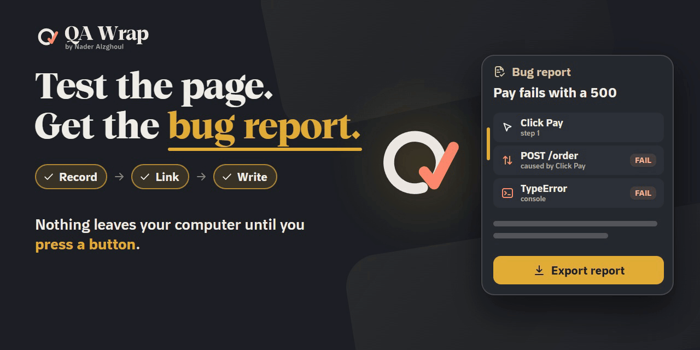

# 🧪 QA Wrap

### اختبر الصفحة. خذ تقرير الخلل جاهزًا.

### 🔒 لا يخرج شيء من حاسوبك قبل أن تضغط زرًّا.

**QA Wrap أداة اختبار جودة تعمل داخل المتصفح وتحفظ كل شيء محليًّا.** تسجّل جلسة الاختبار، وتربط كل خلل بالإجراء الذي سبّبه، وتكتب لك تقرير الخلل. [English](README.md)

🌐 [الموقع](https://nj-burrito.github.io/QA-Wrap/) · ⬇️ [تنزيل آخر إصدار](https://github.com/NJ-Burrito/QA-Wrap/releases/latest) · 🚀 [التثبيت](#التثبيت) · 🔄 [التحديثات](#التحديثات) · 🔒 [الخصوصية](#الخصوصية) · 🧰 [المزيد من NJ](#المزيد-من-nj)

## ⚡ في 10 ثوانٍ

- 🎯 **ما هي:** إضافة للمتصفح تسجّل اختبارك وتكتب تقرير الخلل.
- 🙋 **لمن:** لمن يختبر صفحات الويب ويتعب من إعادة كتابة الخطوات والبحث عن النقرة التي سبّبت كل خلل.
- 🚀 **كيف:** [نزّل الملف المضغوط](https://github.com/NJ-Burrito/QA-Wrap/releases/latest)، فُكّه، ثم **Load unpacked** في `chrome://extensions`. نحو ثلاث دقائق، مرة واحدة. الخطوات الكاملة [أدناه](#التثبيت).

## 🛠️ ماذا تفعل

- 🎬 **تسجّل الجلسة**: تضغط ابدأ، تختبر كالمعتاد، ثم تضغط أوقف. تُحفظ النقرات والكتابة (مع إزالة القيم الحسّاسة) وأخطاء الصفحة وإخفاقات الشبكة بالترتيب.
- 🔗 **تربط كل خلل بسببه**: يُظهر التقرير الإجراء الذي سبق كل مشكلة.
- 📝 **تكتب التقرير**: ضغطة واحدة تنسخ تقرير خلل جاهزًا (العنوان والخطوات وما حدث والأدلة). والإرسال إلى Jira وغيره زر واحد.
- 🌍 **عربي وإنجليزي** معًا، والاتجاه من اليمين إلى اليسار حيث يلزم.

🎞️ [شاهد الفيلم في 40 ثانية](https://nj-burrito.github.io/QA-Wrap/media/qa-wrap-commercial-40s.mp4)

## 🚀 التثبيت

QA Wrap ليست في متجر Chrome، فتُحمَّل يدويًّا، ويشترط Chrome لذلك تشغيل **وضع المطوّر (Developer mode)**. هو مفتاح عادي في Chrome ولا يثبّت شيئًا بنفسه. يلزمك Chrome بإصدار 116 أو أحدث (ويعمل Edge وBrave وChromium بالطريقة نفسها). تعمل على Windows وMac وLinux. المدة نحو ثلاث دقائق، ومرة واحدة فقط.

🌐 متصفحات أخرى (Edge وBrave وOpera وVivaldi وArc وYandex وFirefox وSafari)

| المتصفح | الملف المضغوط (تحت **Assets**) | مكان "Load unpacked" | خطوة أداة التحديث (مرة واحدة) |
| --- | --- | --- | --- |
| Chrome | `qa-wrap-VERSION.zip` | `chrome://extensions` ثم **Developer mode** ثم **Load unpacked** | مجلد `updater`: `install.cmd` أو `install.sh` |
| Edge | `qa-wrap-VERSION-edge.zip` | `edge://extensions` ثم **Developer mode** (القائمة اليسرى) ثم **Load unpacked** | نفسها |
| Brave | `qa-wrap-VERSION-brave.zip` | `brave://extensions` ثم **Developer mode** ثم **Load unpacked** | نفسها |
| Opera | `qa-wrap-VERSION-opera.zip` | `opera://extensions` ثم **Developer mode** ثم **Load unpacked** | نفسها |
| Opera GX | `qa-wrap-VERSION-operagx.zip` | `opera://extensions` ثم **Developer mode** ثم **Load unpacked** | نفسها |
| Vivaldi | `qa-wrap-VERSION.zip` | `vivaldi://extensions` ثم **Developer mode** ثم **Load unpacked** | نفسها |
| Arc | `qa-wrap-VERSION.zip` | `arc://extensions` ثم **Developer mode** ثم **Load unpacked** | نفسها |
| Yandex Browser | `qa-wrap-VERSION.zip` | `browser://extensions` ثم **Developer mode** ثم **Load unpacked** | نفسها |
| Chromium | `qa-wrap-VERSION.zip` | `chrome://extensions` ثم **Developer mode** ثم **Load unpacked** | نفسها |
| Firefox | `qa-wrap-VERSION-firefox.zip` | `about:debugging#/runtime/this-firefox` ثم **Load Temporary Add-on** واختر `manifest.json` | نفسها، عندما تعمل الإضافة موقَّعة (انظر أدناه) |
| Safari | لا يوجد | يلزم جهاز Mac فيه Xcode | غير متاح |

تسجّل خطوة أداة التحديث نفسها لكل متصفح تجده على جهازك وتخبرك بأسمائها. كل متصفح يتحدّث إلى ملفه الخاص، فلا يصل إصدار Firefox أبدًا إلى Edge.

**Firefox.** النسخة الرسمية من Firefox لا تُبقي إلا الإضافة **الموقَّعة** بشكل دائم؛ غير الموقَّعة مؤقتة وتزول عند إعادة تشغيل Firefox. الاستخدام الدائم يحتاج توقيعًا من addons.mozilla.org (AMO) وهذا لم يتم بعد. الأداة تكتب أصلًا ملف Firefox (`allowed_extensions` بمعرّف الإضافة)، فيعمل التحديث بضغطة واحدة مع نسخة موقَّعة.

**Safari.** يحتاج Safari إلى جهاز Mac مع Xcode لتحويل النسخة إلى تطبيق (`xcrun safari-web-extension-converter`)، والتحديث بضغطة واحدة غير متاح هناك.

1. افتح [آخر إصدار](https://github.com/NJ-Burrito/QA-Wrap/releases/latest).
2. تحت **Assets** اضغط على الملف المضغوط لمتصفحك من الجدول (ملف Chrome هو **qa-wrap-VERSION.zip**). يُحفظ في مجلد التنزيلات.
3. أنشئ مجلدًا دائمًا، مثل `C:\QA Wrap`. **لا تستخدم مجلد التنزيلات**: إن حُذف المجلد اختفت QA Wrap من Chrome.
4. اضغط بزر الفأرة الأيمن على الملف المضغوط، واختر **Extract All**، واختر ذلك المجلد، واضغط **Extract**. تأكد أن `manifest.json` ظاهر مباشرة داخل المجلد.
5. في Chrome اكتب `chrome://extensions` في شريط العنوان واضغط Enter.
6. في أعلى الصفحة شغّل **Developer mode**.
7. اضغط **Load unpacked**، واختر المجلد من الخطوة 3، ثم **Select Folder**. تظهر QA Wrap في القائمة.
8. فعّل التحديث التلقائي (مرة واحدة) لتُثبَّت التحديثات من تلقاء نفسها. افتح المجلد من الخطوة 3، ثم افتح بداخله المجلد المسمى `updater`.
   - **Windows**: انقر مرتين على **install.cmd**. تظهر نافذة سوداء بخمس خطوات قصيرة بالعربية والإنجليزية ثم كلمة Done.
   - **Mac أو Linux**: افتح تطبيق Terminal، اكتب `bash ` (مع مسافة بعدها)، اسحب الملف **install.sh** من مجلد `updater` إلى نافذة Terminal، ثم اضغط Enter.
   - لا يحتاج صلاحيات المسؤول ولا يثبّت شيئًا آخر، وآمن إن شغّلته مرتين.
9. اضغط أيقونة قطعة الأحجية في شريط Chrome ثم الدبوس بجانب **QA Wrap**. افتح أي صفحة، واضغط أيقونة QA Wrap، ثم **Wake up**، وسمِّ ما تختبره، ثم **Start**، وعند الانتهاء **Stop**.

قد يعرض Chrome عند التشغيل رسالة "Disable developer mode extensions". اضغط **X** ولا تضغط Disable.

**أبقِ المجلد في مكانه.** التحديث يستبدل الملفات في المجلد نفسه، فتحتفظ QA Wrap بهويتها وبكل ما سجّلته.

## 🔄 التحديثات

عند كل تشغيل لـ Chrome (ثم مرة في اليوم) تسأل QA Wrap موقع GitHub إن كان هناك إصدار أحدث. لا ترسل أي شيء عنك أو عن اختباراتك. إن وُجد، تظهر بطاقة **تحديث** صغيرة في نافذة QA Wrap وفي الإعدادات، ولا تعيقك أبدًا.

- **تحديث**: يطلب Chrome مرة واحدة إذن التحدث مع أداة التحديث من الخطوة 8. اسمح، فتنزّل QA Wrap الإصدار وتتحقق منه وتستبدل الملفات في مجلدك (مع نسخة احتياطية واحدة بجواره، وتراجع تلقائي إن فشل شيء)، ثم تعيد التحميل وتفتح "ما الجديد في هذا الإصدار". لا شيء آخر عليك.
- **ليس الآن**: تغيب البطاقة حتى التشغيل التالي لـ Chrome أو الإصدار التالي.
- جلساتك وتسجيلاتك وملاحظاتك وإعداداتك محفوظة في ملفك الشخصي في Chrome لا في مجلد الإضافة، فلا يمسّها التحديث.
- إن تخطيت الخطوة 8 أو رفضت الإذن، ينزّل زر التحديث الملف المضغوط ويعرض ثلاث خطوات: فُكّه فوق المجلد نفسه، افتح `chrome://extensions`، اضغط **Reload** عند QA Wrap.

🔑 اختياري: النسخ المشتقة والمرايا الخاصة

*اختياري، للنسخ المشتقة (forks) والمرايا الخاصة.* إن شغّلت QA Wrap من نسخة خاصة، يخفي GitHub إصداراتها عمّن لم يسجّل الدخول، فيبقى الفحص صامتًا ما لم تعطه مفتاحًا: في QA Wrap **الإعدادات > التحقق من التحديثات** الصق رمز GitHub للقراءة فقط (رمز دقيق الصلاحية *Contents: read-only* على ذلك المستودع). المستودع العام لا يحتاج رمزًا. يبقى الرمز في ملفك الشخصي بالمتصفح، ويظهر مخفيًّا، ولا يُرسل إلا إلى GitHub. يمكنك حذفه في أي وقت، وإيقاف الفحص من المكان نفسه.

## 🔒 الخصوصية

- كل ما تسجّله QA Wrap يبقى في متصفحك على حاسوبك.
- لا يُرسل شيء إلى أي جهة قبل أن تضغط زرًّا يقول ذلك (مثل الإرسال إلى Jira).
- الطلب التلقائي الوحيد هو فحص التحديث أعلاه: قراءة بسيطة لقائمة الإصدارات في `api.github.com/repos/NJ-Burrito/QA-Wrap`، دون ملفات تعريف ارتباط ودون بيانات شخصية.
- كلمات المرور والرموز وما يشبهها تُزال مما يُسجَّل.

التفاصيل: [سياسة الخصوصية بالعربية](extension/PRIVACY.ar.md) ([English](extension/PRIVACY.md)).

## 🆘 مشكلة؟

افتح بلاغًا (issue) في هذا المستودع، أو راجع المعرض https://nj-burrito.github.io.

## 👤 عن المشروع

- 🎯 **ما هي:** إضافة متصفح مجانية لمن يختبر يدويًا. تسجل جلسة الاختبار وتكتب تقرير الخلل.
- 🙋 **من صنعها:** نادر الزغول، مهندس أتمتة جودة في عمّان، الأردن.
- 📜 **الرخصة:** MIT. الشيفرة معلنة، وتحتفظ المكونات الخارجية برخصها.
- ✉️ **التواصل:** naderalzghoulbusiness@gmail.com

- 💼 [المعرض](https://nj-burrito.github.io/): أعمال نادر ومشاريعه، وفيه قسم التواصل
- 📦 [NJ-Kit](https://nj-burrito.github.io/NJ-Kit/): مهارات لـ Claude Code
- 🪪 [Profile-Wrap](https://nj-burrito.github.io/Profile-Wrap/): ملفك الشخصي كصفحة
- 🐙 [GitHub](https://github.com/NJ-Burrito): الشيفرة وكل المستودعات المفتوحة
- 🔗 [LinkedIn](https://www.linkedin.com/in/nader-alzghoul): ملف نادر

---

حقوق النشر (c) 2026 نادر الزغول. مرخَّص بموجب [رخصة MIT](LICENSE). تحتفظ المكوّنات الخارجية برخصها: انظر [THIRD-PARTY-NOTICES.md](THIRD-PARTY-NOTICES.md).

