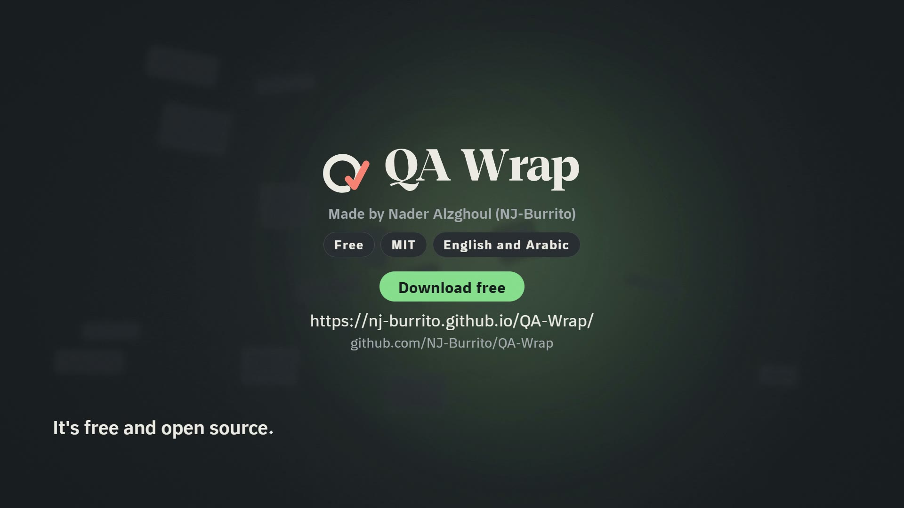

# QA Wrap

## Test the page. Get the bug report.

## Nothing leaves your computer until you press a button.

**QA Wrap is a local-first QA toolkit that lives in your browser.** It records a test session, links every failure to the action that caused it, and writes the bug report for you. [العربية](README.ar.md)

[Website](https://nj-burrito.github.io/QA-Wrap/) · [Download the latest release](https://github.com/NJ-Burrito/QA-Wrap/releases/latest) · [Install](#install) · [Updates](#updates) · [Privacy](#privacy)

## What it does

- **Records a session**: you press Start, test as usual, press Stop. Clicks, typing (sensitive values removed), page errors and network failures are kept in order.
- **Links each failure to its cause**: the report shows the action just before every problem.
- **Writes the report**: one press copies a ready bug report (title, steps, what happened, evidence). Sending to Jira and other trackers is one button away.
- **Arabic and English**, right to left where it should be.

## Install (about 3 minutes, once)

QA Wrap is not in the Chrome Web Store, so you load it by hand. Chrome only allows that with **Developer mode** switched on. It is a normal Chrome switch and installs nothing by itself.

You need Chrome 116 or newer. Chrome and Edge are the tested browsers; Brave and Chromium work the same way. Windows, Mac and Linux are supported.

1. Open the [latest release](https://github.com/NJ-Burrito/QA-Wrap/releases/latest).
2. Under **Assets**, click **qa-wrap-VERSION.zip**. It lands in your Downloads folder.
3. Make a folder where it can stay, for example `C:\QA Wrap`. **Do not use Downloads**: if the folder is deleted, QA Wrap disappears from Chrome.
4. Right-click the zip, choose **Extract All...**, pick that folder, press **Extract**. Open the folder and check that `manifest.json` is directly inside it.
5. In Chrome, type `chrome://extensions` in the address bar and press Enter.
6. Top right, switch **Developer mode** on.
7. Press **Load unpacked**, choose the folder from step 3, press **Select Folder**. QA Wrap appears in the list.
8. Turn on automatic updates (once). Open the folder from step 3, then open the folder called `updater` inside it.
   - **Windows**: double-click **install.cmd**. A black window shows five short steps in English and Arabic and says Done.
   - **Mac or Linux**: open the Terminal app, type `bash ` (with a space after it), drag the file **install.sh** from the `updater` folder into the Terminal window, press Enter.
   - It needs no admin rights and installs nothing else. It is safe to run twice.
9. Click the puzzle-piece icon in the Chrome toolbar and the pin next to **QA Wrap**. Open any page, press the QA Wrap icon, then **Wake up**, name what you are testing, **Start**, and **Stop** when done.

Chrome may show "Disable developer mode extensions" when it starts. Press the **X**; do not press Disable.

**Keep the folder where it is.** The update replaces the files in that same folder, so QA Wrap keeps its identity and everything you recorded.

## How updates work

Each time Chrome starts (and then once a day), QA Wrap asks GitHub whether a newer release exists. It sends nothing about you or your tests. If there is one, a small **Update** card appears in the QA Wrap popup and in Settings. It never blocks you.

- **Update**: Chrome asks once for permission to talk to the updater from step 8. Allow it, and QA Wrap downloads the release, checks it, swaps the files in your folder (keeping one backup copy beside it, and rolling back by itself if anything fails), reloads, and opens "What's new in this version". You do nothing else.
- **Not now**: the card stays away until the next Chrome start or the next version.
- Your sessions, recordings, notes and settings are stored in your Chrome profile, not in the extension folder, so an update never touches them.
- Skipped step 8, or declined the permission? Update then downloads the zip and shows three steps: extract it over the same folder, open `chrome://extensions`, press **Reload** on QA Wrap.

*Optional, for forks and private mirrors.* If you run QA Wrap from a private fork, GitHub hides its releases from anyone not signed in, so the check stays silent unless you give it a key. In QA Wrap **Settings > Check for updates**, paste a read-only GitHub token (a fine-grained token with *Contents: read-only* on that repository). The public repository needs no token. It stays in your browser profile, is shown masked, and is sent only to GitHub. Remove it any time. The check can be switched off in the same place.

## Privacy

- Everything QA Wrap records stays in your browser on your computer.
- Nothing is sent anywhere until you press a button that says so (for example Send to Jira).
- The one automatic request is the update check above: a plain read of the release list at `api.github.com/repos/NJ-Burrito/QA-Wrap`, with no cookies and no personal data.
- Passwords, tokens and similar values are removed from what is recorded.

Details: [PRIVACY.md](extension/PRIVACY.md) ([العربية](extension/PRIVACY.ar.md)).

## Problems?

Open an issue in this repository, or see the portfolio at https://nj-burrito.github.io.

## For developers

Run from source: `chrome://extensions` > Developer mode > **Load unpacked** > pick `extension/`. Tests: `cd extension && npm test`. Release zip: `npm run release:zip` (writes `dist/qa-wrap-<version>.zip`). Pushing a tag `vX.Y.Z` that matches `extension/manifest.json` publishes the release through `.github/workflows/release.yml`. The updater host is `extension/updater/` (PowerShell, registered under HKCU by `install.cmd`).

| Folder | What is in it |
| --- | --- |
| [extension/](extension/) | The product (Chrome MV3; Edge takes the same package). |
| [identity/](identity/) | The mark, palette, tokens and lockups, all generated from `tools/`. |
| [research/](research/) | What was studied and found: the tool landscape, benchmarks, field tests. |
| [skills/](skills/) | The lessons this project taught, written as a skill. |
| [deliverables/](deliverables/) | The tutorial films, recorded from the product. |

---

Copyright (c) 2026 Nader Alzghoul (NJ-Burrito). Released under the [MIT licence](LICENSE). Third-party components keep their own licences: see [THIRD-PARTY-NOTICES.md](THIRD-PARTY-NOTICES.md).
